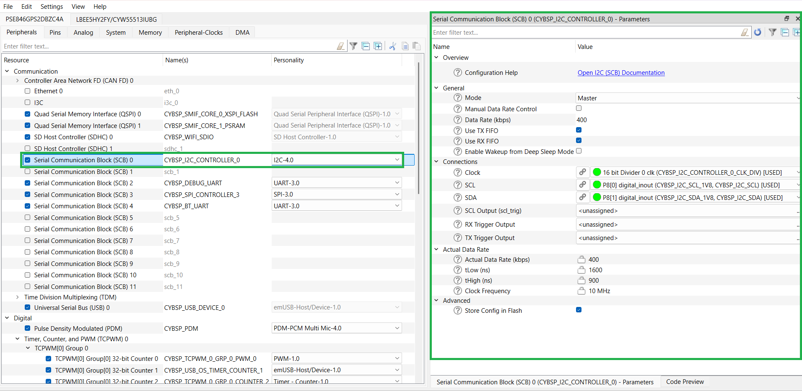

# Texas Instruments TLV320DAC3100 low-power stereo audio DAC with audio processing and mono Class-D speaker amplifier driver library for ModusToolbox&trade;

## Overview

This is the driver library supporting a [Texas Instruments TLV320DAC3100 low-power stereo audio DAC with audio processing](https://www.ti.com/product/TLV320DAC3100?utm_source=google&utm_medium=cpc&utm_campaign=asc-null-null-GPN_EN-cpc-pf-google-ww_en_cons&utm_content=TLV320DAC3100&ds_k=TLV320DAC3100&DCM=yes&gad_source=1&gad_campaignid=14388345080&gbraid=0AAAAAC068F2_uiPre6qxMuUbQf1WNXJ9Y&gclid=EAIaIQobChMIjs-c0I7DjgMVs8c8Ah3nsRcwEAAYASAAEgLDcPD_BwE&gclsrc=aw.ds) on PSOC&trade; Edge E84 Evaluation Kit (`KIT_PSE84_EVAL_EPC2`, `KIT_PSE84_EVAL_EPC4`).

## Quick start

Follow these steps to add the driver in an application for PSOC&trade; Edge MCU Evaluation Kit (`KIT_PSE84_EVAL_EPC2`, `KIT_PSE84_EVAL_EPC4`).

  1. Create a [PSOC&trade; Edge MCU: Empty application](https://github.com/Infineon/mtb-example-psoc-edge-empty-app) by following "Create a new application" section in [AN235935 – Getting started with PSOC&trade; Edge E84 MCU on ModusToolbox&trade;](https://www.infineon.com/AN235935) application note

  2. Add this *audio-codec-tlv320dac3100* library to the application using Library Manager

  3. The Serial Communication Block (SCB) is configured as an I2C controller in the Device Configurator tool as follows:

      - Enable **Serial Communication Block (SCB)** resource and configure the same for display driver in Device Configurator as shown for the project created in **Step 1**<br>

        **Figure 1. SCB I2C master configuration in Device Configurator**

        


  4. Save the modified configurations in Device Configurator

  5. Use the driver as shown in the following code snippet:

  ```cpp

  #include "cybsp.h"
  #include "mtb_tlv320dac3100.h"

  /*******************************************************************************
  * Macros
  *******************************************************************************/
  #define MCLK_HZ                             (6144000u)
  #define I2C_FREQUENCY_HZ                    (400000)
  #define DELAY_IN_MS                         (10000u)
  #define VOLUME_VALUE                        (100u)

  /*******************************************************************************
  * Global variables
  ********************************************************************************/

  /* I2C controller context */
  cy_stc_scb_i2c_context_t CYBSP_I2C_CONTROLLER_context;
  mtb_hal_i2c_t CYBSP_I2C_CONTROLLER_hal_obj;
  mtb_hal_i2c_configurator_t CYBSP_I2C_CONTROLLER_hal_config;
  mtb_hal_i2c_cfg_t CYBSP_I2C_SLAVE_config =
  {
      .is_target = false,
      .address = MTB_TLV320DAC3100_I2C_ADDR,
      .frequency_hz = I2C_FREQUENCY_HZ,
      .address_mask = MTB_HAL_I2C_DEFAULT_ADDR_MASK,
      .enable_address_callback = false
  };

  /*****************************************************************************
  * Code
  *****************************************************************************/

  int main(void)
  {
      cy_rslt_t result;
      cy_en_scb_i2c_status_t i2c_result;

      /* Initializes the device and board peripherals. */
      result = cybsp_init();

      /* Board initialization failed. Stops program execution. */
      if (CY_RSLT_SUCCESS != result)
      {
          CY_ASSERT(0);
      }

      /* Enables global interrupts. */
      __enable_irq();


      /* Initializes the I2C in master mode. */
      i2c_result = Cy_SCB_I2C_Init(CYBSP_I2C_CONTROLLER_HW,
                                 &CYBSP_I2C_CONTROLLER_config,
                                 &CYBSP_I2C_CONTROLLER_context);

      if (CY_SCB_I2C_SUCCESS  != i2c_result)
      {
          CY_ASSERT(0);
      }

      Cy_SCB_I2C_Enable(CYBSP_I2C_CONTROLLER_HW);

      /* Configures the I2C master interface with the desired clock frequency. */
      result = mtb_hal_i2c_setup(&CYBSP_I2C_CONTROLLER_hal_obj,
                               &CYBSP_I2C_CONTROLLER_hal_config,
                               &CYBSP_I2C_CONTROLLER_context,
                               NULL);

      if (CY_SCB_I2C_SUCCESS != i2c_result)
      {
          CY_ASSERT(0);
      }

      /* Configures the I2C block. Master/slave-specific functions only work when the block is configured to desired mode. */
      result = mtb_hal_i2c_configure(&CYBSP_I2C_CONTROLLER_hal_obj,
                                   &CYBSP_I2C_SLAVE_config);
      if (CY_RSLT_SUCCESS != result)
      {
          CY_ASSERT(0);
      }

      /* Initializes and configures the TLV320DAC3100 audio codec. */
      result = mtb_tlv320dac3100_init(&CYBSP_I2C_CONTROLLER_hal_obj);
      if (CY_SCB_I2C_SUCCESS != i2c_result)
      {
          CY_ASSERT(0);
      }

      /* Configures internal clock dividers to achieve the desired sample rate. */
      result = mtb_tlv320dac3100_configure_clocking(MCLK_HZ, TLV320DAC3100_DAC_SAMPLE_RATE_16_KHZ, TLV320DAC3100_I2S_WORD_SIZE_16, TLV320DAC3100_HP_AUDIO_OUTPUT);
      if (CY_SCB_I2C_SUCCESS != i2c_result)
      {
          CY_ASSERT(0);
      }


      for (;;)
      {
          /* Deactivates TLV320DAC3100 audio codec. */
          mtb_tlv320dac3100_deactivate();

          /* Updates the volume of both the left and right channels of the speaker output. */
          mtb_tlv320dac3100_adjust_speaker_output_volume(VOLUME_VALUE);

          Cy_SysLib_Delay(DELAY_IN_MS);

          /* Updates the volume of both the left and right channels of the headphone output. */
          mtb_tlv320dac3100_adjust_headphone_output_volume(VOLUME_VALUE);

          Cy_SysLib_Delay(DELAY_IN_MS);

          /* Activates TLV320DAC3100 audio codec. */
          mtb_tlv320dac3100_activate();
      }
  }
  ```

## More information

For more information, see the following:

* [API Reference Guide](./API_reference.md)
* [ModusToolbox&trade; software environment, quick start guide, documentation, and videos](https://www.infineon.com/modustoolbox)
* [Infineon Technologies AG](https://www.infineon.com)


---
© 2025 - 2026, Cypress Semiconductor Corporation (an Infineon company)
